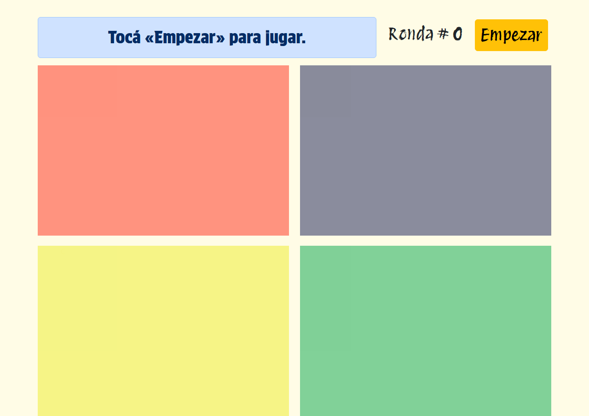

# Simón Dice con Bootstrap

Juego de memoria visual basado en **Simón Dice**, hecho con HTML, CSS y JavaScript vanilla, con Bootstrap para el layout responsive.

La máquina agrega un cuadro a la secuencia en cada ronda y la reproduce completa. El jugador debe repetirla en el mismo orden. Un clic equivocado termina la partida.

## Demo

https://tejedasebastian.github.io/simon-dice-bootstrap/

## Captura



## Cómo jugar

1. Tocá **Empezar**.
2. Mirá la secuencia de cuadros que ilumina la máquina.
3. Cuando el estado diga **Turno del jugador**, repetí la secuencia haciendo clic en los cuadros.
4. Si acertás toda la secuencia, empieza una ronda nueva con un cuadro más.
5. Si te equivocás, la partida termina. Tocá **Empezar** para volver a jugar.

## Stack

- HTML5 y CSS3
- JavaScript vanilla (ES6)
- [Bootstrap 5.3.2](https://getbootstrap.com/) por CDN, con atributo `integrity` (SRI)
- Google Fonts (Protest Revolution, Protest Strike, Fjalla One, Playfair Display)
- [Playwright](https://playwright.dev/) para tests end-to-end
- GitHub Pages para la demo

## Estructura

```text
.
├── .github/workflows/e2e.yml   # CI: tests E2E y artifact
├── docs/
│   └── captura.png             # captura usada en el README
├── tests/
│   ├── game.spec.js            # tests E2E
│   └── server.js               # servidor estático para los tests
├── index.html
├── main.css
├── main.js
├── icono.png
├── playwright.config.js
├── package.json
├── LICENSE
└── README.md
```

## Correr el proyecto

El sitio es estático: también se puede abrir `index.html` directamente en el navegador. Para servirlo por HTTP en el puerto **4182**:

```bash
npm install
npm start
```

Luego abrí http://127.0.0.1:4182.

## Tests

El proyecto no tiene tests unitarios. La cobertura es end-to-end con Playwright sobre Chromium.

```bash
npm install
npx playwright install chromium
npm test
```

Los tests levantan el servidor estático en el puerto **4182** y cubren:

- Flujo completo: ronda 1 → ronda 2 → derrota → reinicio.
- Bloqueo del tablero durante el turno de la máquina.
- Reinicio en medio de una secuencia (cancelación de timers).
- Doble clic en **Empezar**.
- Vistas móviles de 390 px y 320 px: sin overflow horizontal, assets cargados y sin errores de consola.

Resultados:

- Reporte HTML: `artifacts/html-report/index.html` (se abre con `npm run show-report`).
- Reporte JSON: `artifacts/results.json`.

En GitHub Actions el workflow [`.github/workflows/e2e.yml`](.github/workflows/e2e.yml) corre los tests en cada push a `main` y en cada pull request, y sube `artifacts/` como artifact.

## Limitaciones

- La dificultad es fija: solo cambia la longitud de la secuencia.
- No se guardan récords ni progreso entre sesiones.
- No hay sonido ni vibración.
- El tablero se controla con clic o toque; no hay navegación por teclado.
- Bootstrap y Google Fonts se cargan desde CDN, así que el estilo completo requiere conexión a internet.
- No hay tests unitarios.

## Licencia

Distribuido bajo licencia [MIT](LICENSE).

Hecho por [Sebastian Tejeda](https://github.com/tejedasebastian).
